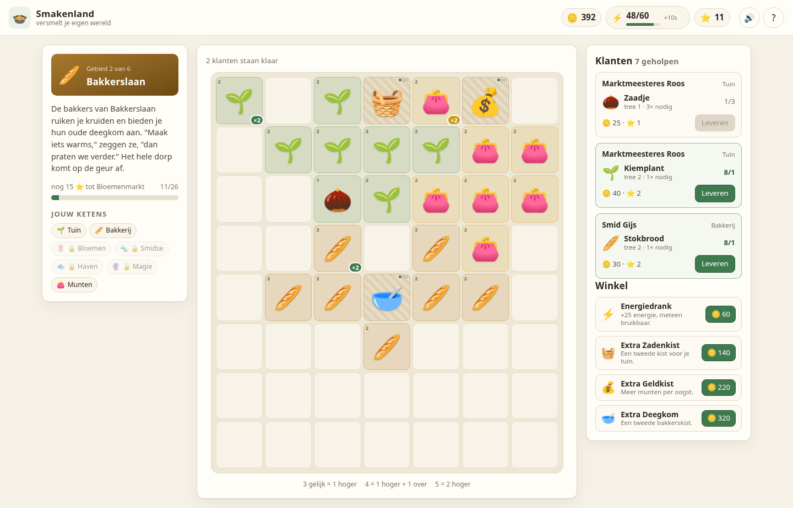
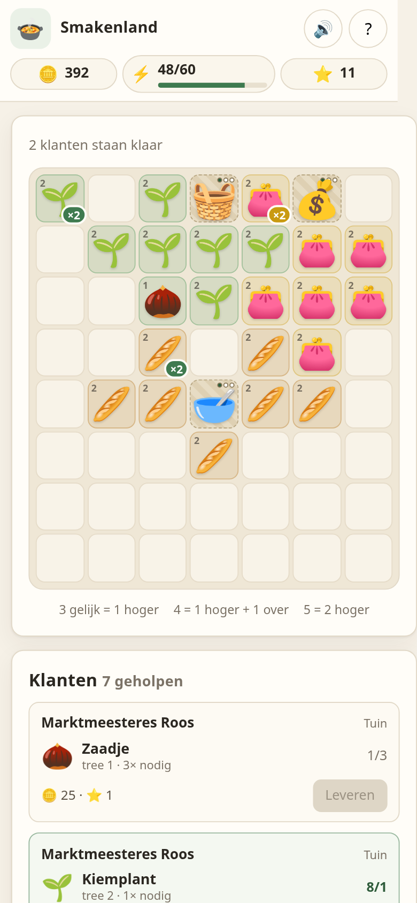

# Smakenland 🍲

Een merge-spel voor de browser: **oogst uit kisten, versmelt drie gelijke items en reis door
Smakenland.** Geïnspireerd op het genre van *Tasty Travels*, *EverMerge* en *Fable Town* — versmelten
als kern, energie als tempo, kisten als generatoren, klanten als opdrachtgevers en een verhaalwereld die
zich per gebied ontvouwt.

Speelt op de computer én op de telefoon, werkt offline (PWA), en bewaart je potje in de browser.

## Spelen

Direct online: **https://theberas04.github.io/smakenland/**

Of lokaal:

```bash
python3 -m http.server 8080        # in deze map
# open http://localhost:8080
```

Op een telefoon: open het adres en kies **Zet op beginscherm** — daarna start het spel als een app en
werkt het zonder internet.

## Hoe het speelt

- **Tik op een kist** (🧺 zadenkist, 💰 geldkist, 🥣 deegkom …) — die oogst een item en kost energie ⚡.
  Energie groeit vanzelf weer aan.
- **Sleep twee gelijke items op elkaar** — ze stapelen. De derde die erbij komt versmelt tot één item een
  tree hoger. Twee gelijke items op een cel is dus de tussenstand, geen einddoel.
- **Slim stapelen loont**: 3 gelijk wordt 1 hoger, **4 gelijk wordt 1 hoger + 1 over**, 5 gelijk wordt 2 hoger.
- **Drie dezelfde kisten** op elkaar geven een kist van niveau 2 — die oogst meteen een tree hoger (en
  kost 2 energie in plaats van 1).
- **Munten** tap je aan om ze te innen; in de winkel koop je energie en extra kisten.
- **Klantenorders** leveren munten en ⭐ sterren. Genoeg sterren opent een nieuw gebied, met een eigen
  verhaal, een nieuwe keten en een nieuwe kist.

Zeven ketens van zes treden: Tuin 🌰→🍛, Bakkerij 🌾→👑, Bloemen 🍀→🌸, Smidse ⛏️→🏆, Haven 🐚→🐉,
Magie ✨→🌟 en Munten 🪙→💎. Zes gebieden van Smakendorp tot de Sterrenkeuken.

## Beeld





## Zo is het gebouwd

| bestand | wat het doet |
| --- | --- |
| `content.js` | alle inhoud: ketens, kisten, gebieden met verhaal, winkelartikelen |
| `engine.js` | de spellogica, puur en zonder DOM: bord, versmelten, energie, orders, gebied, opslag |
| `app.js` | de pagina: bord tekenen, slepen, effecten, geluid, bewaren |
| `styles.css` | huisstijl: papier en inkt, licht thema, geen schaduwen of neon |
| `sw.js`, `manifest.webmanifest` | offline werken en "zet op beginscherm" |
| `tools/render_icons.py` | tekent het app-icoon (een pan) met Chromium, zonder Pillow |
| `tests/engine.test.mjs` | 22 tests op de spellogica |
| `tests/smoke.mjs` | 51 controles op de echte pagina in een headless DOM |
| `scripts/shoot.py` | speelt het spel in Chromium en maakt de schermafbeeldingen hierboven |
| `scripts/check-live.py` | laadt een uitgerolde kopie in een echte browser, speelt één zet en meldt JS-fouten |

`engine.js` is bewust DOM-vrij en werkt zowel in de browser als in Node, zodat de tests exact dezelfde
regels gebruiken als het spel. Dezelfde RNG (met de seed in de save) maakt potjes herhaalbaar.

## Controles

```bash
node --test "tests/*.test.mjs"                    # spellogica
python3 -m http.server 8231 &                     # de pagina moet geserveerd worden
node tests/smoke.mjs 8231                         # de pagina zelf, in jsdom
python3 tools/render_icons.py                     # iconen opnieuw tekenen
python3 scripts/shoot.py 8231                     # schermafbeeldingen opnieuw maken
python3 scripts/check-live.py <url>               # controleer een uitgerolde kopie echt in de browser
```

## Wat er nog niet is

- Geen geluid op iOS zonder tik vooraf (dat eist de browser zo), en geen muziek.
- Geen app-store-versie: dit is een webspel/PWA. Een Android-app (WebView + APK) kan er in dezelfde
  WebView-route omheen gebouwd worden.
- De klanten zijn vaste wensen uit de ontgrendelde ketens; er zit nog geen verhaallijn per klant achter.

## Licentie

Alle rechten voorbehouden. De gebruikte emoji komen van het besturingssysteem van de speler, niet uit
dit project.