# Smakenland 🍲

**Versmelt items in 1200 levels, los sudoku's op en reis door een verhalenwereld.** Een spel voor de
browser én als Android-app, in het genre van *Tasty Travels*, *EverMerge* en *Fable Town*: versmelten als
kern, energie als tempo, kisten als generatoren, klanten als opdrachtgevers.

[**Speel direct in de browser**](https://theberas04.github.io/smakenland/) ·
[**Download de Android-app**](https://github.com/Theberas04/smakenland/releases/latest) ·
[**Bekijk de demo (41 s)**](docs/smakenland-demo.mp4)

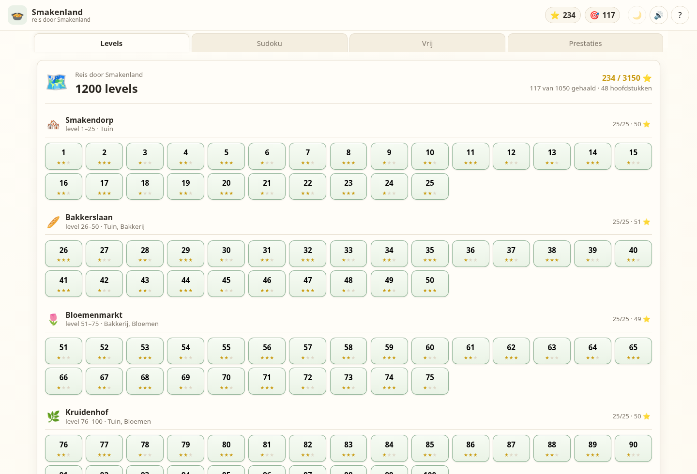

[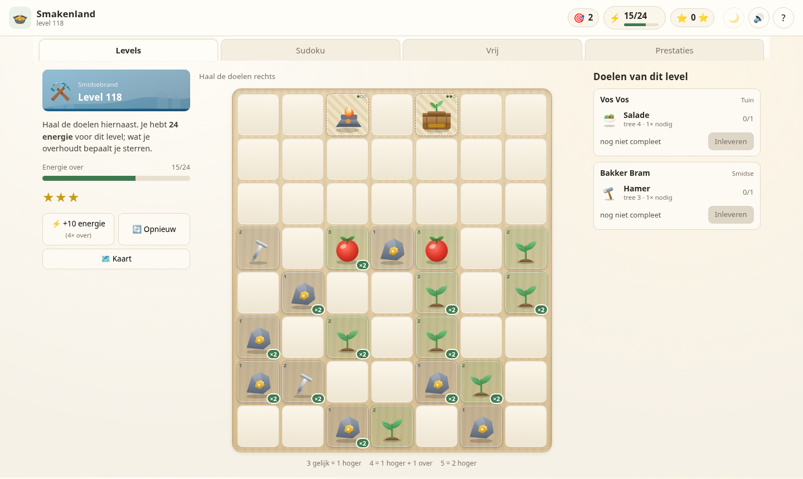](docs/smakenland-demo.mp4)

## Wat er in zit

- **1200 levels** over 48 hoofdstukken, met een levelkaart en sterren. Elk level heeft vaste doelen en
  een eigen energietegoed; wat je overhoudt bepaalt je sterren (3 bij ≥ 40 % over). De generator
  *berekent* dat tegoed uit de doelen — een item van tree 5 maken kost 3⁴ oogsten van een kist van
  niveau 1 — en `tools/gen_levels.py --check` rekent na dat alle 1200 levels met dat tegoed te halen zijn.
  De eerste 800 levels zijn precies dezelfde gebleven, zodat bestaande voortgang blijft kloppen.
- **Seizoenshoofdstukken**: naast de veertig gewone hoofdstukken heeft elk seizoen twee eigen
  hoofdstukken (lente, zomer, herfst, winter). Je ziet alleen het seizoen dat het op dat moment is,
  het eerste level van zo'n zijpad staat meteen open en de kaart vermeldt wat er in de andere seizoenen
  klaarstaat. Dat is te toetsen: `seizoenVanMaand`, `zichtbareHoofdstukken` en `levelOpen` krijgen een
  seizoen mee, dus er zit geen blik op de klok midden in de spellogica.
- **Prestaties**: twintig dingen om te halen (eerste level, honderd versmeltingen, een hoofdstuk op
  drie sterren, een sudoku van 16×16, zeven dagen op rij) met een eigen scherm, voortgangsbalken en een
  klein venster als je er een haalt. De regels staan in `prestaties.js` en zijn los te toetsen.
- **Voortgangscode**: je sterren, munten, sudokutijden, prestaties en thema in één stuk tekst, om te
  bewaren of over te zetten naar een ander toestel. De code heeft een korte controle: zit er een fout
  in, dan weigert de app hem in plaats van er halve voortgang van te maken.
- **Donker thema**: één knop in de balk (of de voorkeur van je toestel bij het eerste bezoek). Alle
  kleuren zitten in variabelen, zodat geen enkel onderdeel vergeten kan worden.
- **Sudoku** in vijf maten (4×4, 6×6, 9×9, 12×12 en 16×16) en drie moeilijkheden, met notities,
hints, foutenteller, klok en je beste tijd per maat en niveau. Vanaf 12×12 komen er letters bij de
cijfers (A t/m G), net als in een echte sudoku van die maat.
  Elke opgave heeft precies één oplossing (nagerekend met een bitmasker-oplosser).
- **Versmelten**: sleep twee gelijke items op elkaar, de derde versmelt tot één item een tree hoger.
  Alleen door te slepen — een oogst legt nooit iets vanzelf op een stapel.
  4 gelijk geeft 1 hoger + 1 over, 5 gelijk geeft er 2. Drie dezelfde kisten op elkaar geven een kist
  van niveau 2, die meteen een hogere tree oogst.
- **Zeven ketens** van zes treden: Tuin 🌰→🍛, Bakkerij 🌾→👑, Bloemen 🍀→🌸, Smidse ⛏️→🏆,
  Haven 🐚→🐉, Magie ✨→🌟 en Munten 🪙→💎.
- **Vrij spelen** naast de levels: klanten met wensen, munten, een winkel en een reis langs zes
  gebieden met eigen verhaal.
- **Alles getekend, geen pictogrammen-lettertype**: 39 items, 7 kisten en 6 geschilderde
  gebiedsachtergronden, allemaal SVG uit één bron (`tools/gen_art.py`).

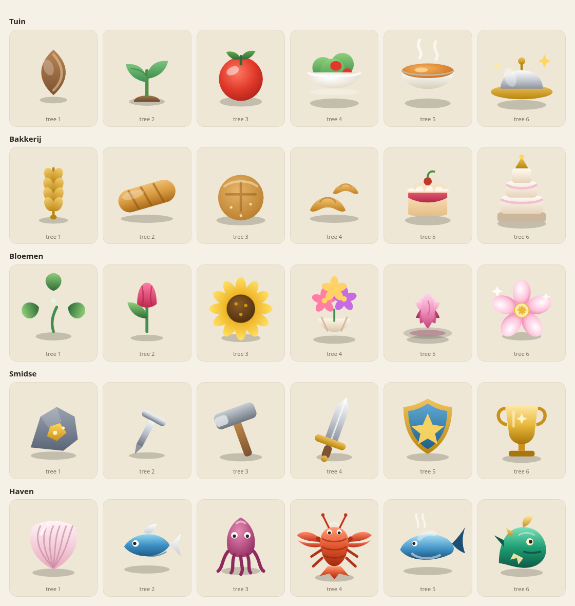

## Beeld

| Level spelen | Sudoku | Vrij spelen |
| --- | --- | --- |
|  | 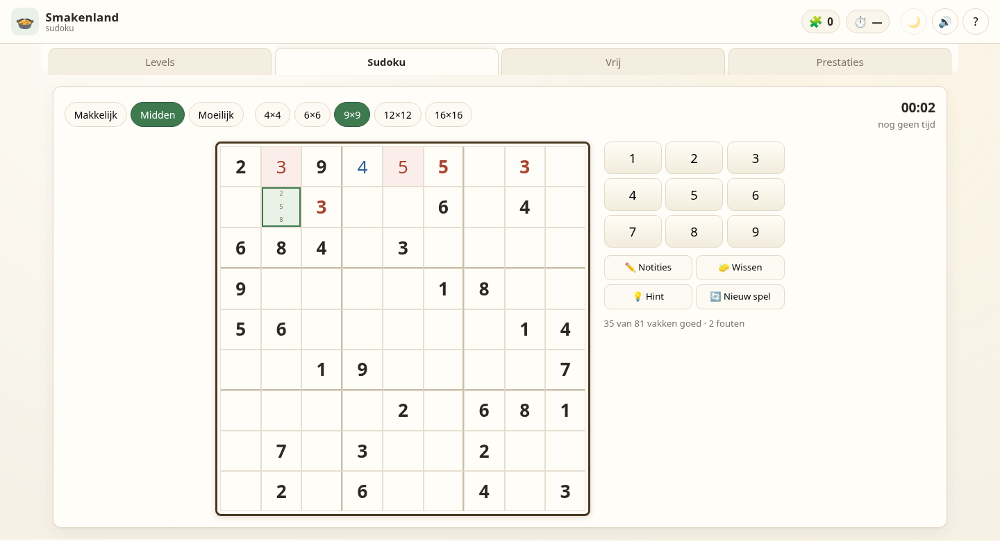 | 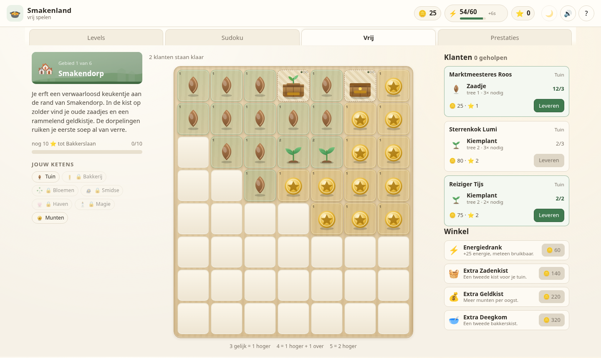 |
| Sudoku van 16×16 | Sudoku op de telefoon (16×16) | Sudoku op de telefoon (4×4) |
| 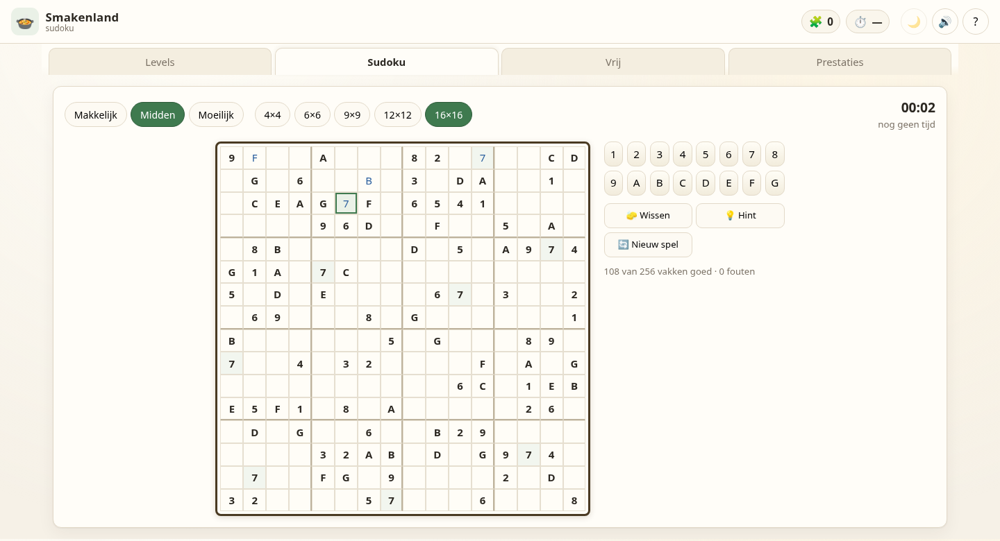 | 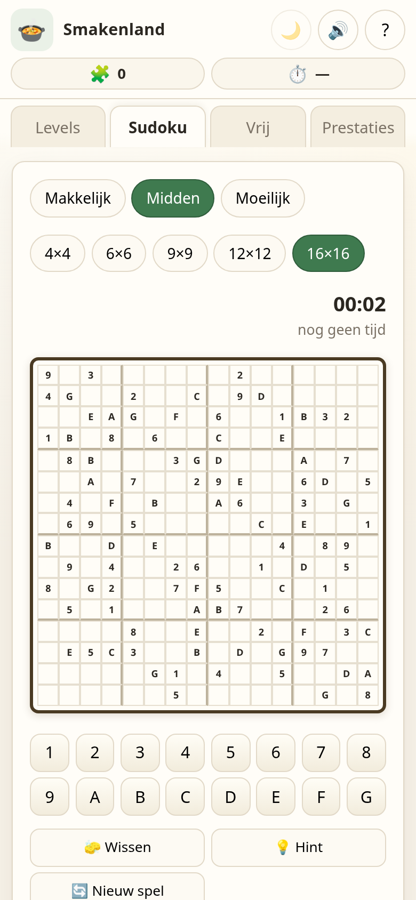 | 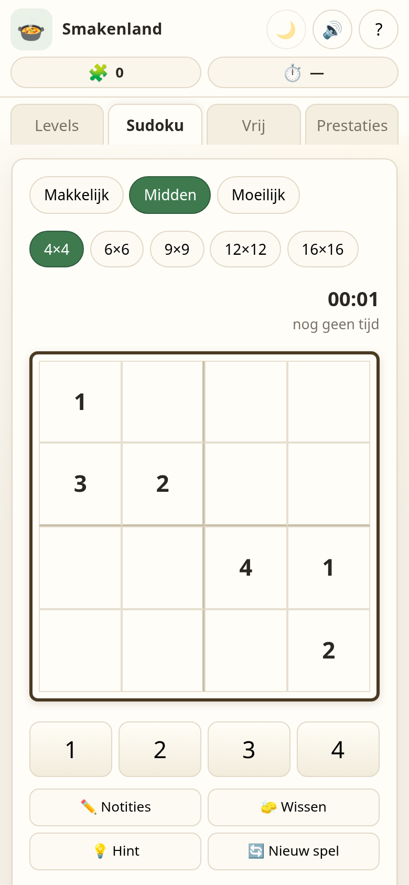 |
| Prestaties | Seizoenshoofdstukken | Donker thema |
| 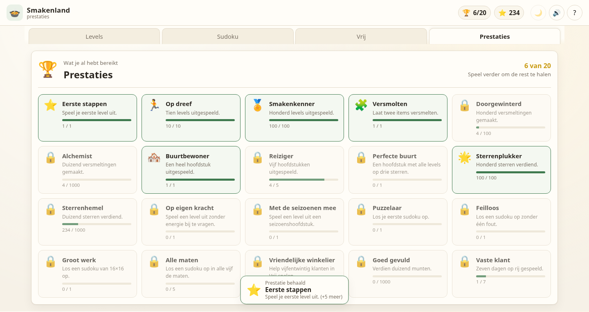 | 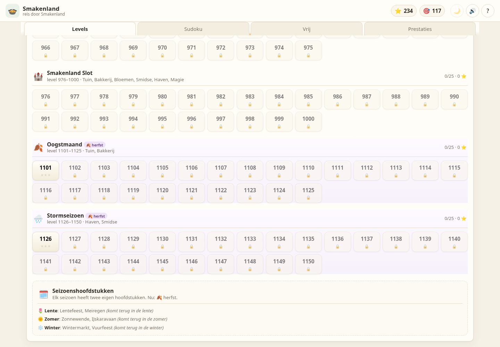 | 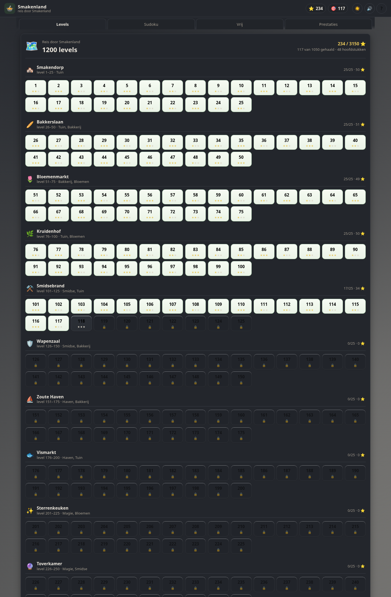 |

| Telefoon · level | Telefoon · levelkaart |
| --- | --- |
| 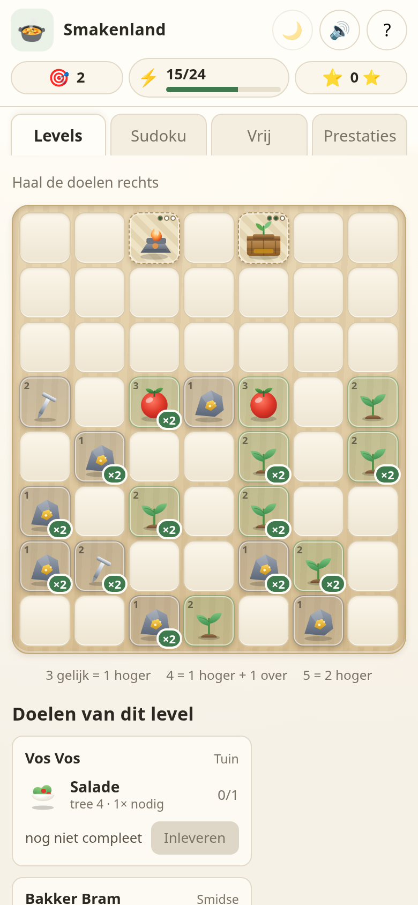 | 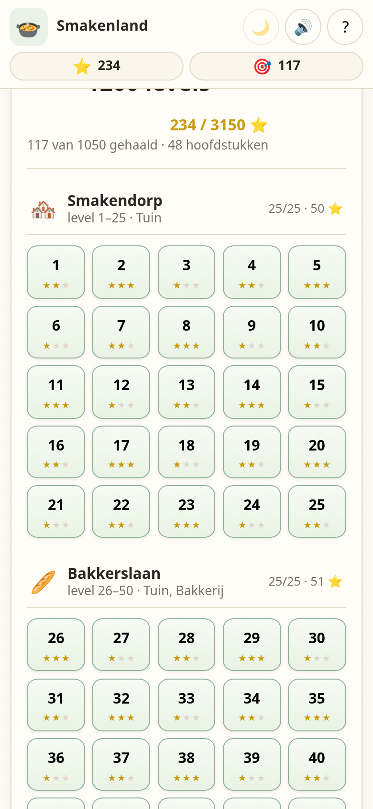 |

## Zo speel je

- **Tik op een kist** — die oogst een item en kost energie ⚡ (1 tot 3, naar het niveau van de kist).
  Het item komt altijd op een **vrij vak**: er wordt niets vanzelf op elkaar gelegd, dus je bepaalt zelf
  of en wanneer er iets versmelt. In een level is het tegoed vast; in vrij spelen groeit energie vanzelf aan.
- **Sleep twee gelijke items op elkaar** — ze stapelen, de derde versmelt.
- **Lever de doelen in** (of bij vrij spelen: de klanten): dat levert sterren op. Genoeg sterren opent
  in vrij spelen een nieuw gebied; in de levels gaat het level ermee op slot.
- **Vastgelopen?** Je mag per level **vier keer** om "⚡ +10 energie" vragen — de knop telt af
  ("4× over") en gaat daarna op. Het tegoed én het maximum gaan samen omhoog, zodat je sterren niet
  opgeblazen worden. Een "opnieuw"-knop begint het level vers.

## Android-app

De app is een dunne WebView-schil om dezelfde bestanden: geen internetverbinding nodig (het recht staat
zelfs niet in het manifest), alles zit in de bundel en je potje blijft op het toestel bewaard.

- APK: [releases](https://github.com/Theberas04/smakenland/releases/latest) — ondertekend met de vaste
  Smakenland-sleutel, dus elke volgende versie installeert over de vorige heen.
- Bouwen gaat via GitHub Actions (`.github/workflows/android.yml`): één job maakt de ondertekende
  release-APK en controleert de handtekening, het versienummer en de inhoud van de bundel; een tweede
  job bouwt een debug-APK, speelt hem op een emulator en zet foto's van de drie schermen in
  `docs/android/`.
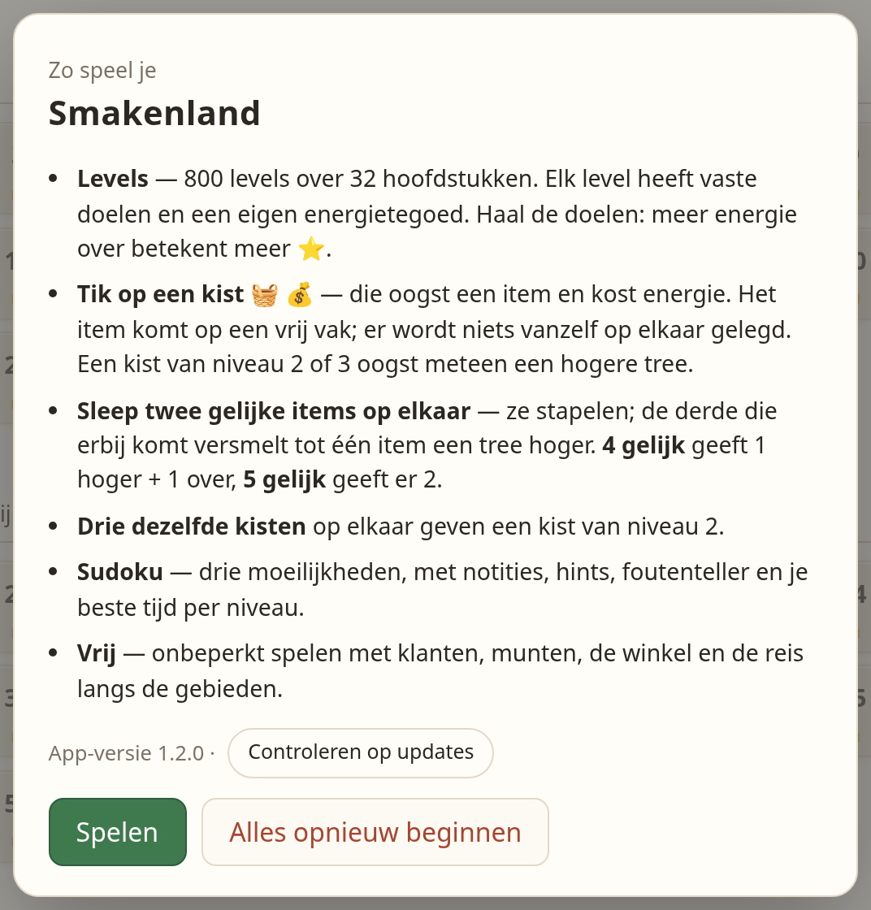

*De updateregel zoals de Android-app hem in de uitleg toont — hier nagemaakt in de browser met
dezelfde brug die de app aan het venster hangt, want in een browser hoort die regel er niet te staan.*

- **De app kijkt zelf of er een nieuwe versie is.** Bij het starten vraagt hij één keer bij GitHub
  naar de nieuwste uitgave (`api.github.com/repos/Theberas04/smakenland/releases/latest`), vergelijkt
  het versienummer met wat er op het toestel staat en biedt aan om bij te werken. In de uitleg staat
  "App-versie 1.2.0" met een knop om het zelf te controleren. Zonder internet mislukt die controle
  stil: het spel werkt gewoon door.
- Op je eigen netwerk zetten kan ook: de map is statische bestanden, dus een `python3 -m http.server`
  in een LXC volstaat.

## Zo is het gebouwd

| bestand | wat het doet |
| --- | --- |
| `content.js` | ketens, kisten, gebieden met verhaal, winkel |
| `art.js` | alle getekende kunst (gegenereerd, niet met de hand aanpassen) |
| `levels.js` | de 800 levels (gegenereerd) |
| `engine.js` | de spellogica: bord, versmelten, energie, doelen, levels, gebieden, opslag |
| `sudoku.js` | sudokuregels voor alle maten: generator met unieke oplossing, oplosser, hints |
| `sudokus.js` | kant-en-klare 16×16-opgaven uit `tools/gen_sudokus.js` (nagerekend: één oplossing) |
| `prestaties.js` | de twintig prestaties en hun regels (los te toetsen) |
| `voortgangscode.js` | je voortgang in één code, met een controle op typefouten |
| `tools/gen_sudokus.js` | maakt en narekent die 16×16-opgaven (`--check`) |
| `app.js` | de schil: tabs, bord, slepen, effecten, geluid, bewaren |
| `sudoku-view.js` | het sudokupaneel |
| `styles.css` | huisstijl: papier en inkt, hout op het bord, geen schaduwen of neon |
| `android/` | de WebView-app en het icoon |
| `tools/gen_art.py` | tekent alle kunst (`--check` vergelijkt met `art.js`) |
| `tools/gen_levels.py` | maakt de 800 levels en rekent ze na (`--check`) |
| `tools/render_icons.py` | het app-icoon in alle maten (web + Android) |
| `tools/contactsheet.py` | één overzichtsbeeld van alle kunst |
| `scripts/sync-assets.sh` | zet de webapp in de bundel van de Android-app |
| `scripts/shoot.py` | speelt het spel in Chromium en maakt de schermafbeeldingen |
| `scripts/record-demo.py` | neemt de demo op (echte tikken en slepen, daarna ffmpeg) |
| `scripts/check-live.py` | laadt een uitgerolde kopie in een echte browser en meldt JS-fouten |
| `scripts/shoot-update.py` | fotografeert de updateregel met dezelfde brug als de app |
| `android/.../Updates.java` | het versierekenwerk van de updatecontrole (gewone Java, te testen) |

De spellogica is DOM-vrij en werkt in de browser én in Node, zodat de tests precies dezelfde regels
gebruiken als het spel. De generator van de levels en de sudoku gebruiken een seed, zodat een potje
herhaalbaar is en de tests niet gokken.

## Controles

```bash
node --test "tests/*.test.mjs"                    # spellogica: bord, levels, sudoku, prestaties, code (70 tests)
python3 -m http.server 8231 &                     # de pagina moet geserveerd worden
node tests/smoke.mjs 8231                         # de pagina zelf in jsdom (115 controles)
python3 scripts/check-live.py <url>               # een uitgerolde kopie in een echte browser
javac -d /tmp/ut android/app/src/main/java/nl/werdens/smakenland/Updates.java \
      tests/java/UpdatesTest.java && java -cp /tmp/ut UpdatesTest   # versierekenwerk (28 controles)
javac -d /tmp/st android/app/src/main/java/nl/werdens/smakenland/Schermen.java \
      tests/java/SchermenTest.java && java -cp /tmp/st SchermenTest # schermnamen (25 controles)
node tools/gen_sudokus.js --check                 # de 16 kant-en-klare 16×16-opgaven zijn uniek
python3 tools/gen_art.py --check                  # kunst loopt niet uit de pas met de generator
python3 tools/gen_levels.py --check               # en alle 1200 levels zijn nog haalbaar
python3 scripts/shoot.py 8231                     # schermafbeeldingen opnieuw
python3 scripts/record-demo.py 8231               # de demo opnieuw opnemen
```

## Wat er nog niet is

- Geen muziek, en op iOS blijft geluid stil tot je één keer tikt (dat eist de browser zo).
- Geen app-store-versie: dit is een webspel/PWA plus een losse APK, geen Play-uitgave.
- De sudoku bewaart één potje tegelijk; wisselen van moeilijkheid of maat begint een nieuwe puzzel.
- De voortgangscode gaat over je voortgang (sterren, munten, tijden, prestaties, thema); het losse bord
  van Vrij spelen zit er niet in, want dat is de stand van dit moment en geen voortgang.
- De 16×16 met veel lege vakken komt kant-en-klaar uit `sudokus.js`: die in de app maken kost
  seconden tot minuten, want bij zo'n groot bord wordt het narekenen van "precies één oplossing"
  razendsnel veel werk. De generator in de app blijft voor alle andere maten, en kan door een
  zoekbudget nooit blijven hangen.
- Notities staan uit vanaf 12×12: zestien tekens in een vakje van twintig pixels is niet te lezen.
- Klanten in vrij spelen hebben vaste wensen uit de ontgrendelde ketens, zonder eigen verhaallijn.

## Licentie

Alle rechten voorbehouden.
